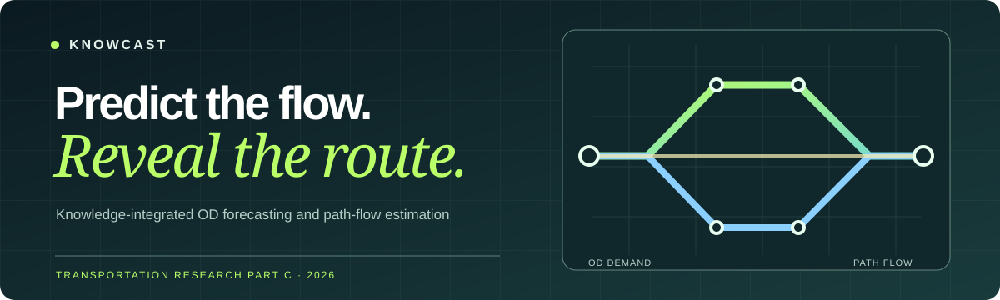
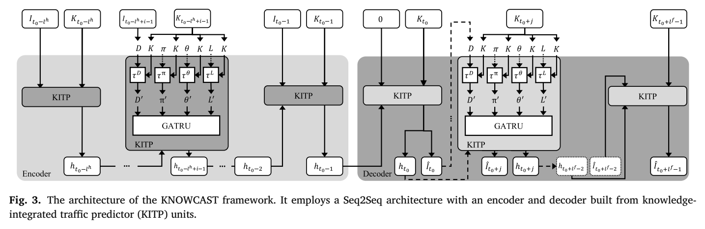
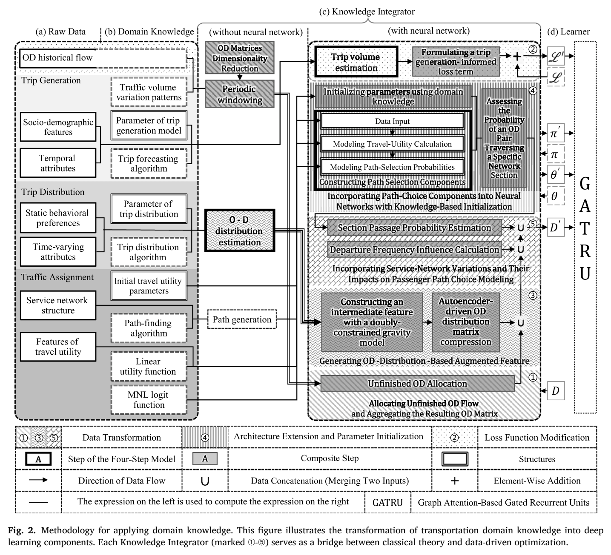
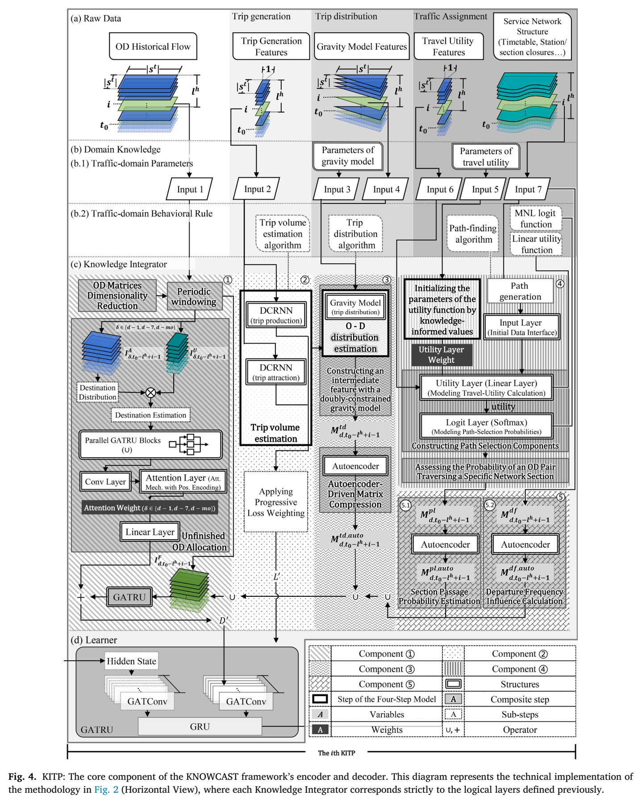

  

<h1 align="center">KNOWCAST</h1>

<strong>Domain-knowledge-integrated deep learning for metro OD forecasting and path flow estimation</strong>

<strong>Hao Zheng¹ · Han Zheng²* · George Giannopoulos³</strong> 
¹ Tsinghua University &nbsp; ² Beijing Jiaotong University &nbsp; ³ Aristotle University of Thessaloniki (emeritus)

<strong>Transportation Research Part C: Emerging Technologies · Volume 189 · 2026 · Article 105710</strong>

<strong>Website:</strong> <a href="https://scholarhaozheng.github.io/KNOWCAST/">KNOWCAST on GitHub Pages</a>

<strong>Transportation theory inside the learning process.</strong> 
Forecast metro demand and infer how it moves through the network in one coupled framework.

**Algorithm companion:** Read the [pseudocode guide](PSEUDOCODE_GUIDE.md) for the complete data, model, training and evaluation procedures.

[Overview](#overview) · [Architecture](#architecture) · [Results](#main-results) · [Ablations](#ablation-studies) · [Path-flow evidence](#path-flow-and-section-load-evidence) · [Citation](#citation) · [Pseudocode guide](#pseudocode-guide)

---

  

<em>Figure 3 from the paper. Knowledge-integrated traffic predictor units connect historical demand, transportation knowledge, and future OD forecasts.</em>

> **At a glance:** 154 stations · 17 transfer stations · 15-minute intervals · 10 forecasting baselines. 
> KNOWCAST achieves **1.02 MAE**, **3.04 RMSE**, and **54.25% WMAPE** on the reported test task.

## Overview

KNOWCAST (**Knowledge-Integrated OD Forecasting and Path-Flow Estimation**) combines transportation knowledge with a sequence-to-sequence deep learning model. It jointly forecasts short-term metro origin–destination (OD) demand and infers path flows through an embedded, differentiable assignment mechanism.

The central challenge is partial observability: Automated Fare Collection (AFC) records identify entry and exit stations and times, but do not reveal the route taken inside a metro network. Meanwhile, service changes, demographic context, and time-varying demand influence both the amount of travel and its distribution.

KNOWCAST addresses these challenges by incorporating **trip generation, trip distribution, and traffic assignment** into the model’s features, loss, architecture, and parameter initialization. Its inferred path flows remain structurally coupled to its OD forecasts.

### What the paper contributes

- **Structured knowledge integration.** Transportation mechanisms translate influencing factors into model components rather than leaving all relationships to be learned from concatenated inputs.
- **Coupled OD and path-flow outputs.** A trainable utility layer and Logit assignment connect OD forecasts to topology-feasible candidate paths without requiring path-level training labels.
- **Interpretable adaptation.** Knowledge-derived utility parameters provide initial values and are refined during training; their trajectories can be inspected.
- **Empirical evaluation.** The study compares ten baselines, tests individual and combined components, examines a second learner architecture, and assesses section-load plausibility using sampled observations.

### Reading map

| Paper section | Focus |
| --- | --- |
| **1 · Introduction** | AFC observability, influencing-factor integration, behavioral mechanisms, and joint OD/path modeling |
| **2 · Literature review** | Classical transportation, statistical, machine learning, and spatiotemporal deep learning methods; knowledge integration and assignment gaps |
| **3 · Framework** | Four integration mechanisms and the knowledge-integrated encoder–decoder |
| **4 · KITP** | Five Knowledge Integrators, unfinished-trip allocation, progressive loss, gravity features, Logit assignment, service representations, path/section inference, and GATRU |
| **5 · Experiments** | Data and tuning, baseline comparisons, ablations, computational cost, indirect operational assessment, and task-setting sensitivity |
| **6 · Conclusion** | Findings, interpretation boundaries, transfer potential, and future work |

The [published paper](https://doi.org/10.1016/j.trc.2026.105710) contains the full derivations and reference list.

## Architecture

### Four ways to integrate transportation knowledge

  

<em>Figure 2 from the paper. Knowledge integration modifies the data, loss, architecture, and parameter initialization.</em>

| Integration mechanism | How KNOWCAST uses it |
| --- | --- |
| **Data transformation** | Constructs transportation-informed features from distribution, route choice, and service conditions |
| **Loss modification** | Adds a station-level trip-generation consistency term with a decaying weight |
| **Architecture extension** | Embeds behavioral and network mechanisms, including a differentiable Logit assignment component |
| **Parameter initialization** | Initializes selected trainable utility coefficients from transportation knowledge |

### Five Knowledge Integrators inside KITP

The **Knowledge-Integrated Traffic Predictor (KITP)** is the building block used throughout the encoder and decoder.

| Component | Role | Implementation |
| --- | --- | --- |
| **1 · Unfinished OD allocation** | Reconstructs a more complete historical demand representation | Origin-specific selective aggregation; previous-day, previous-week, and previous-month destination patterns; parallel GATRUs and attention gating |
| **2 · Trip generation** | Provides station-level structural guidance during early training | A pre-trained DCRNN estimates production and attraction from station catchment and temporal features; a consistency loss guides the main model |
| **3 · Trip distribution** | Encodes shifts in inter-station demand | A doubly constrained gravity model, iterative proportional fitting, and an autoencoder produce distribution features |
| **4 · Path choice** | Connects transportation behavior to differentiable assignment | Path attributes → trainable linear utilities → Multinomial Logit probabilities |
| **5 · Service network** | Encodes the effects of operational conditions | Section-use probabilities and line-specific departure-frequency matrices are compressed into task-specific representations |

  

<em>Figure 4 from the paper. The KITP connects knowledge-derived features and objectives to a graph-attention recurrent learner.</em>

### Encoder, decoder, and learner

The encoder consumes realized historical data over a lookback window of length $l_h$. The decoder predicts the next $l_f$ intervals, starting from the final encoder state and a zero OD input. Subsequent decoder steps use the preceding ground-truth OD matrix during training and the preceding prediction during inference.

The decoder omits the three unfinished-trip GATRUs because future unfinished-trip observations are unavailable at the prediction origin. Future exogenous inputs must be known, announced, or forecastable at that time; these can include planned headways, service notices, weather forecasts, and public event schedules.

The **Graph Attention Gated Recurrent Unit (GATRU)** combines:

1. **Graph attention**, which learns how neighboring stations contribute within the physical network’s feasible attention neighborhoods.
2. **Gated recurrent updates**, which capture temporal evolution using those spatial features and the preceding hidden state.

Distribution, path-choice, and service-frequency autoencoders are first pre-trained for reconstruction, then their encoders are fine-tuned with the forecasting model.

## Key mechanisms and equations

The selected equations below retain the notation and indices used in the paper. Here, $d,t$ identify the day and time interval, $m,n$ identify stations, and $\mathrm{RDS}_m$ is the set of explicitly retained destinations for origin $m$.

### Observe finished trips; allocate unfinished trips

For each origin, the row total of actual raw OD demand equals finished trips plus entries whose journeys are still unfinished (paper Eq. 2):

$$
\sum_{n\in\mathrm{STN}} I^{\mathrm{raw},A}_{d,t}(m,n)
=
\sum_{n\in\mathrm{STN}} I^{\mathrm{raw},F}_{d,t}(m,n)
+
I^{\mathrm{raw},U}_{d,t}(m),\qquad \forall m\in\mathrm{STN}.
$$

Historical destination shares from the previous day, week, and month allocate current unfinished counts. A uniform distribution is used if a reference row has zero total flow. Separate recurrent representations are fused with attention-based gates.

### Compress destination dimensions while preserving origin totals

For each origin, the model retains the highest-volume destinations identified **only from the training period** and aggregates all remaining destinations into the last column, indexed by $|\mathrm{RDS}|+1$ (paper Eq. 4):

$$
I^X_{d,t}\!\left(m,|\mathrm{RDS}|+1\right)
=
\sum_{n\in\mathrm{STN}\setminus\mathrm{RDS}_m}
I^{\mathrm{raw},X}_{d,t}(m,n),
\qquad X\in\{A,F\}.
$$

The destination mapping remains fixed during training, validation, and testing. The reported **0.23 retention ratio is a matrix-dimension retention ratio**. It is not a statement that only 23% of passenger volume is retained: the residual column preserves the remaining origin-level flow.

### Guide early training with trip generation

The generation loss penalizes disagreement between estimated station production/attraction and the corresponding totals implied by the OD prediction. Destination totals use a fixed training-period allocation of residual flows. The auxiliary weight and total objective are given separately in paper Eqs. 17 and 19:

$$
w_g(\varepsilon)
=
w_g(0)\cdot\max\!\left(1-\alpha_{\mathrm{decay}}\cdot\varepsilon,0\right).
$$

$$
\mathcal L_{\mathrm{total}}^{(\varepsilon)}
=
\mathcal L_{\mathrm{OD}}
+
w_g(\varepsilon)\cdot\mathcal L_g.
$$

The main OD objective is MAE in the original flow-value scale. With the selected $\alpha_{\mathrm{decay}}=0.1$, the auxiliary weight decays to zero over the first ten epochs.

### Estimate distribution with a gravity model

The doubly constrained trip-distribution feature uses production, attraction, balancing coefficients, and impedance (paper Eq. 20):

$$
\gamma^{\mathrm{TD}}_{(m,n),d,t}
=
B^O_{m,d,t}P_{m,d,t}
B^D_{n,d,t}A_{n,d,t}
f(c_{mn,d,t}),
\qquad f(c)=e^{-\zeta c},\ \zeta>0.
$$

Production $P$, attraction $A$, and generalized impedance $c$ vary with conditions. The deterrence coefficient $\zeta$ is pre-calibrated offline and held fixed during main-model training; balancing coefficients are updated through iterative proportional fitting.

### Infer paths and sections from OD forecasts

For candidate path $p_{\mathrm{od},r}$, a trainable utility function and Logit normalization yield path-choice probabilities (paper Eqs. 22–23). We write $p_r$ when the OD pair is clear:

$$
U_{\mathrm{od},r,d,t}
=
\sum_{\phi=1}^{\Phi}
\beta_{\phi}\psi_{\phi,d,t}(p_{\mathrm{od},r}).
$$

$$
\Pr_{d,t}(p_r\mid\mathrm{od})
=
\frac{\exp(U_{\mathrm{od},r,d,t})}
{\sum_{p_\xi\in\mathcal P_{\mathrm{od}}}\exp(U_{\mathrm{od},\xi,d,t})}.
$$

For a forecast at offset $\lambda$, the model converts predicted OD demand into path and directed-section flows (paper Eqs. 28–29):

$$
\mathrm{PathFlow}^{(d,t,\lambda)}_{m,n_m^{(\tilde n)},p_r}
=
\widehat I^{(d,t,\lambda)}_{m,n_m^{(\tilde n)}}\,
\Pr^{(d,t,\lambda)}\!\left(p_r\mid m,n_m^{(\tilde n)}\right).
$$

$$
\begin{aligned}
\mathrm{LinkFlow}_{d,t,\lambda,\eta,\mu}
&=
\sum_{m\in\mathrm{STN}}
\sum_{\tilde n=1}^{|\mathrm{RDS}|}
\widehat I^{(d,t,\lambda)}_{m,n_m^{(\tilde n)}} \\
&\quad\cdot
\sum_{p_r\in\mathcal P_{m,n_m^{(\tilde n)}}}
\Pr^{(d,t,\lambda)}\!\left(p_r\mid m,n_m^{(\tilde n)}\right)
u_{(p_r,(\eta,\mu))}.
\end{aligned}
$$

Here, $n_m^{(\tilde n)}$ is the $\tilde n$-th retained destination for origin $m$, and $u_{(p_r,(\eta,\mu))}$ indicates whether path $p_r$ traverses directed section $(\eta,\mu)$. The inner destination sum stops at $|\mathrm{RDS}|$; the residual column $|\mathrm{RDS}|+1$ is excluded because it has no single destination or unique candidate-path set.

The Softmax normalization has no trainable parameters. The utility coefficients are trainable, and path probabilities sum to one for each OD pair.

## Data and experimental setup

### City S Metro

| Item | Reported setting |
| --- | --- |
| Network | An anonymized major metropolitan metro system in Eastern China |
| Coverage | Lines 1, 2, 3, 4, the branch of Line 4, and Line 5 |
| Stations / interchanges | **154 stations / 17 transfer stations** |
| Raw OD matrix | **154 × 154 = 23,716 entries**, including diagonal entries |
| Time resolution | **15 minutes** |
| Training | **March 1–31, 2023** |
| Temporal gap | **April excluded** between training and evaluation |
| Validation | **May 1–10, 2023** |
| Test | **May 11–20, 2023** |
| Main comparison target | Fixed **0.23 OD matrix-dimension retention ratio** for every model |
| Training scale | More than **16 million effective spatiotemporal data points** after selective aggregation |

Operational variation includes weekday/weekend transitions, headway changes, and holiday demand. Timetables and service notices supply operational inputs. Population raster data and district-level census information are fused within **800 m station catchments** to estimate population, working-age shares, educational profiles, and household size. Temporal and event features provide additional station context.

### Training and selected hyperparameters

Hyperparameters were selected with **Optuna**, using a **TPE sampler**, **MedianPruner**, and **SQLite storage**. The study ran **80 trials**, with **at most 40 epochs per trial**, minimizing validation MAE; the best configuration occurred at **Trial 78** and was followed by a full training run. Baselines were also tuned using Bayesian optimization.

| Hyperparameter | Selected value |
| --- | ---: |
| Base learning rate | 0.00653 |
| Dropout probability | 0.442 |
| Recurrent hidden units | 96 |
| GAT feature dimension | 256 |
| Initial trip-generation loss weight | 0.0264 |
| Loss decay rate | 0.1 |
| Additional distribution dimension | 5 |
| Additional section feature dimension | 6 |
| Initial per-station utility coefficient | −0.30 |
| Initial transfer utility coefficient | −0.573 |

<strong>Hyperparameter search space from Table 2</strong>

| Hyperparameter | Search space |
| --- | --- |
| Loss decay rate | {0.01, 0.05, 0.1, 0.2, 0.5} |
| Learning rate | [10⁻⁵, 10⁻²], log-uniform |
| Dropout | [0.0, 0.5], uniform |
| Recurrent hidden units | {64, 96, 128, 192} |
| GAT feature dimension | {256, 512, 768} |
| Trip-generation loss weight | [10⁻⁵, 10⁻¹], log-uniform |
| Distribution dimension | {2, 3, 4, 5} |
| Section feature dimension | {5, 6, 7, 8} |

Metrics are calculated separately for each prediction horizon and then averaged. MAE and RMSE are in passenger-flow units; WMAPE is the total absolute error divided by the total observed flow. SMAPE is used for the segmented demand analysis. Test curves shown in the paper are post-hoc diagnostics and were not used for tuning or model selection.

## Main results

**Table 3 · OD prediction performance. Lower is better.**

| Model | MAE ↓ | RMSE ↓ | WMAPE ↓ |
| --- | ---: | ---: | ---: |
| LSTM | 1.41 | 6.48 | 76.36% |
| DCRNN | 1.49 | 8.12 | 80.69% |
| GConvGRU | 1.48 | 7.65 | 80.15% |
| GConvLSTM | 1.36 | 5.61 | 73.65% |
| GCLSTM | 1.38 | 5.95 | 74.73% |
| LRGCN | 1.38 | 5.79 | 74.73% |
| TGCN | 1.38 | 6.04 | 74.73% |
| A3T-GCN | 1.46 | 6.61 | 79.06% |
| AGCRN | 1.36 | 5.61 | 73.65% |
| STConv | 1.50 | 6.95 | 81.23% |
| **KNOWCAST** | **1.02** | **3.04** | **54.25%** |

Relative to the strongest reported baseline values, KNOWCAST reduces **MAE by 25.0%**, **RMSE by 45.8%**, and **WMAPE by 26.3%**. The WMAPE change is **19.40 percentage points**. These reductions are calculated from the rounded values in Table 3.

The paper’s time-series examples show that the model follows major demand patterns while smoothing some abrupt, short-lived peaks. The reported validation/test RMSE difference is linked to the magnitude of extreme errors; it does not establish that the test period is generally easier.

### Performance across the demand distribution

| OD group | Share of passenger flow | Share of OD pairs | WMAPE | SMAPE |
| --- | ---: | ---: | ---: | ---: |
| High-volume · Head | 30% | 6.2% | 47.0% | 67.0% |
| Mid-volume · Body | 50% | 37.5% | 70.4% | 111.1% |
| Low-volume · Tail | 20% | 56.3% | 95.4% | 142.5% |

Sparse flows amplify percentage errors. Across **4,361,831 zero-flow instances** in the Tail group, the average prediction is **0.10 passengers**, with a maximum absolute prediction of **8.52**. Corresponding average predictions are **0.74** for Body and **1.75** for Head zero-flow instances.

## Ablation studies

All cases below retain Component 1 for unfinished-trip processing and selective aggregation. **C2** denotes trip generation, **C3** distribution, **C4** utility/path choice, **C5.1** section probabilities, and **C5.2** departure frequency.

**Tables 4–5 · Component configurations and final forecasting performance.**

| Case | Learner and configuration | MAE ↓ | RMSE ↓ | WMAPE ↓ |
| --- | --- | ---: | ---: | ---: |
| **2** | **GATRU · Full KNOWCAST** | **1.02** | **3.04** | **54.25%** |
| 2b | GATRU · Full model without C2 | 1.02 | 3.06 | 54.27% |
| 2c | GATRU · C2 with temporal features only | 1.02 | 3.08 | 54.42% |
| 3 | GATRU · Component 1 only | 1.24 | 5.19 | 67.15% |
| 3b | GATRU · Exogenous inputs through a generic MLP | 1.21 | 4.85 | 65.53% |
| 4 | GATRU · + C2 | 1.22 | 5.12 | 66.07% |
| 5 | GATRU · + C3 | 1.14 | 3.64 | 61.74% |
| 6 | GATRU · + C5.2 | 1.21 | 4.20 | 65.53% |
| 7 | GATRU · + C4 with fixed utilities + C5.1 | 1.19 | 3.92 | 64.44% |
| 8 | GATRU · + C4 with trainable utilities + C5.1 | 1.10 | 3.45 | 59.57% |
| 9 | GConvLSTM · Component 1 only | 1.35 | 5.58 | 73.10% |
| 10 | GConvLSTM · + C2 | 1.35 | 5.57 | 72.64% |
| 11 | GConvLSTM · + C3 | 1.24 | 4.41 | 67.15% |
| 12 | GConvLSTM · + C5.2 | 1.32 | 5.32 | 73.01% |
| 13 | GConvLSTM · + C4 with fixed utilities + C5.1 | 1.31 | 4.66 | 70.94% |

The results distinguish several effects: distribution and trainable route-choice features improve final prediction metrics; service-frequency features help reduce large errors; and knowledge integration also benefits the alternative GConvLSTM learner.

### Trip generation principally improves the early training trajectory

**Table 6 · Comparison at epoch 30.**

| Configuration | MAE ↓ | RMSE ↓ | WMAPE ↓ |
| --- | ---: | ---: | ---: |
| Full features · Case 2 | **1.138** | **4.401** | **58.11%** |
| No trip generation · Case 2b | 1.277 | 5.729 | 65.20% |
| Temporal features only · Case 2c | 1.221 | 5.927 | 62.39% |

Final MAE reaches 1.02 in all three cases. The main benefit of trip generation and socio-demographic context is therefore **stronger early guidance and more efficient convergence**, with limited effect on the final asymptotic accuracy.

### Learned utility parameters

In Case 8, the utility coefficients evolve from **−0.30 to approximately −1.25** for station traversal and from **−0.573 to approximately −0.77** for transfers. Breakpoint analysis identifies transitions near epochs **55** and **68**, respectively.

These are **forecasting-calibrated operational coefficients for the studied network**. They are not directly measured population preferences or universally transferable behavioral constants.

## Computational efficiency

**Table 7 · Measurements on the reported CPU workstation.**

| Model | Training time / epoch | Inference latency / batch |
| --- | ---: | ---: |
| GConvLSTM · Case 9 | 22.5 s | 1,250 ms |
| Base GATRU · Case 3 | 24.9 s | 1,351 ms |
| GATRU + generic MLP · Case 3b | 28.7 s | 1,485 ms |
| KNOWCAST · Case 2 | 43.8 s | 2,150 ms |

The workstation used two Intel Xeon Gold 5318Y CPUs at 2.10 GHz, **48 physical cores**, **96 logical threads**, and **503 GiB memory**. Latency is a single validation forward pass per batch, averaged over five consecutive epochs; it is not a per-passenger or per-OD latency.

## Path-flow and section-load evidence

The model estimates path flows from predicted retained-OD demand and learned choice probabilities. Those estimates are aggregated to directed sections. Figure 14 in the paper shows average section density and the 33 largest cumulative directed section-flow entries.

**Path-level ground-truth labels are unavailable.** The empirical assessment therefore compares aligned train-load estimates with sampled observations, rather than validating individual paths or continuous section flows directly.

The observation protocol covers **14 fixed daily time slices over 10 days**. Annotators count passengers in one designated carriage of a selected train; a corridor- and period-calibrated factor expands those counts to train-level observations. The modeled flows undergo:

1. **Scale compensation** for destinations represented only by the residual OD column.
2. **Gaussian temporal dispersion** to account for downstream travel delay and spread.
3. **Dynamic headway conversion** from section volumes to train loads.

**Table 8 · Three-level error tracing on representative congested sections.**

| Section | Line | Micro OD WMAPE | Spatial aggregate WMAPE | Final load WMAPE | Pearson $r$ |
| --- | --- | ---: | ---: | ---: | ---: |
| JL → M | 1 | 46.87% | 11.80% | 22.76% | 0.863 |
| SRS → SJ | 2 | 57.57% | 19.13% | 23.27% | 0.780 |
| SW → S | 3 | 57.49% | 19.33% | 21.23% | 0.926 |
| H → Q | 4 | 73.13% | 37.68% | 25.75% | 0.916 |
| N → X | 5 | 73.15% | 34.40% | 28.19% | 0.865 |

Final load WMAPE ranges from **21.23% to 28.19%**, with correlations of **0.780–0.926**. These results support **indirect operational plausibility** after alignment. Carriage expansion and residual inter-carriage imbalance remain sources of uncertainty.

## Forecasting-task sensitivity

| Task setting | MAE ↓ | RMSE ↓ | WMAPE ↓ |
| --- | ---: | ---: | ---: |
| Short context: $l_h=2,\ l_f=4$ | 1.30 | 4.70 | 61.89% |
| Longer horizon: $l_h=4,\ l_f=12$ | 1.60 | 8.00 | 74.55% |
| 15% matrix-dimension retention | 0.86 | 2.65 | 43.67% |
| 80% matrix-dimension retention | 1.72 | 9.41 | 77.94% |

Shorter historical context and longer forecast horizons make prediction harder. Retention settings require a different interpretation: stronger compression changes the prediction target by aggregating more sparse destinations. Its lower errors should not be interpreted as improved accuracy on an unchanged full OD matrix.

## Scope and future work

- **One-city validation.** Cross-city transfer and evolving-network generalization remain potential applications requiring further evaluation.
- **Unobserved routes.** Path estimates are structurally constrained inferences, and direct path-level accuracy is not established.
- **Residual demand.** Path and section inference covers explicitly retained OD pairs; the aggregate residual is excluded from direct assignment.
- **Long-tail errors.** Percentage errors remain high on sparse OD pairs, even when absolute predictions on zero-flow cases are small.
- **Complex interactions.** Further work should quantify sensitivity to knowledge-based initialization and nonlinear interactions among Knowledge Integrators.
- **Disruption scenarios.** Emergency evacuations and more complex operational disruptions are proposed directions for future study.

## Pseudocode guide

The algorithms are presented as non-executable `.pseudo` files in the original module directories. Start with the [complete reading guide](PSEUDOCODE_GUIDE.md), then follow the workflow below.

| Step | Read | Covers |
| --- | --- | --- |
| Prepare data and knowledge | [Artifact pipeline](generating_domain_knowledge_no_DO_clean.pseudo) | AFC, network topology, timetables, destination maps and knowledge inputs |
| Follow the forecasting model | [KNOWCAST model](models/Net_0207.pseudo) | Knowledge encoders, gravity, path choice and recurrent OD forecasting |
| Understand training | [Training procedure](train_save_history.pseudo) | Objective, parameter updates, validation and checkpoints |
| Review configuration search | [Hyperparameter search](bayes_opt.pseudo) | Trial configuration, pruning and model selection |
| Evaluate predictions | [Shared evaluation](train_evaluate_functions.pseudo) and [checkpoint evaluation](evaluate_button.pseudo) | Sample alignment, original-scale metrics and prediction exports |
| Inspect the experiments | [Ablation and sensitivity](experiments/ablation_and_sensitivity.pseudo) · [Operational loads](experiments/operational_load_assessment.pseudo) | Component comparisons, task settings and train-load assessment |

The [module inventory](audit/SOURCE_COVERAGE.md) maps all 42 original modules to their counterparts. [Shared interfaces](specs/interface_contracts.md), [paper settings](specs/paper_settings.yaml) and [implementation parameters](specs/implementation_parameters.md) describe the data and configuration passed between them. For an executable implementation, see the [required inputs and checks](REPRODUCIBILITY.md).

[Edition status](REPOSITORY_STATUS.md) describes the provenance and scope of this paper-method pseudocode companion.

### Repository layout

~~~text
PSEUDOCODE_GUIDE.md
config.pseudo
generating_domain_knowledge_no_DO_clean.pseudo
train_save_history.pseudo · bayes_opt.pseudo · evaluate_button.pseudo
train_evaluate_functions.pseudo
dmn_knw_gnrtr/ · lib/ · metro_components/ · metro_data_convertor/ · models/
experiments/ · visualization_tools/ · specs/ · audit/
docs/                        research website, paper reader and figures
~~~

### Preview the website

To serve the research website locally, run from the repository root:

~~~bash
python -m http.server 4173 --directory docs
~~~

Then open [the local preview](http://localhost:4173). You can also open [docs/index.html](docs/index.html) directly in a browser.

**中文阅读说明：** 主页保留论文介绍、图表和结果展示；完整算法请从[伪代码指南](PSEUDOCODE_GUIDE.md)进入仓库阅读。网页内容、样式和交互分别位于 `docs/index.html`、`styles.css` / `refine.css` 和 `app.js`，上面的命令用于本地预览网页。

## Data availability and authorship

The article states: **“Data will be made available on request.”** City S is anonymized under the data provider’s confidentiality agreement.

**Corresponding author:** Han Zheng · [han_zheng@bjtu.edu.cn](mailto:han_zheng@bjtu.edu.cn)

| Author | Contributions reported in the paper |
| --- | --- |
| Hao Zheng | Conceptualization, data curation, formal analysis, investigation, methodology, software, validation, visualization, and original draft |
| Han Zheng | Conceptualization, data curation, formal analysis, investigation, methodology, project administration, resources, supervision, validation, and review/editing |
| George Giannopoulos | Conceptualization, data curation, formal analysis, investigation, methodology, supervision, and review/editing |

The authors declare no competing interests. This work was supported by the **Talent Fund of Beijing Jiaotong University**, Grant **2024XKRC055**.

## Citation

If you use or discuss KNOWCAST, please cite:

~~~bibtex
@article{zheng2026knowcast,
  title   = {{KNOWCAST}: Domain-knowledge-integrated deep learning for metro {OD} forecasting and path flow estimation},
  author  = {Zheng, Hao and Zheng, Han and Giannopoulos, George},
  journal = {Transportation Research Part C: Emerging Technologies},
  volume  = {189},
  pages   = {105710},
  year    = {2026},
  doi     = {10.1016/j.trc.2026.105710},
  url     = {https://doi.org/10.1016/j.trc.2026.105710}
}
~~~

  <a href="https://doi.org/10.1016/j.trc.2026.105710">Read the paper</a>
  &nbsp; · &nbsp;
  <a href="PSEUDOCODE_GUIDE.md">Read the pseudocode guide</a>

完整论文阅读器：[paper.html](docs/paper.html)，含原始37页PDF和逐页文本。

---

## Acknowledgement

This repository partially builds upon the [HIAM](https://github.com/HCPLab-SYSU/HIAM) project. We sincerely appreciate their contributions to the open-source community.
