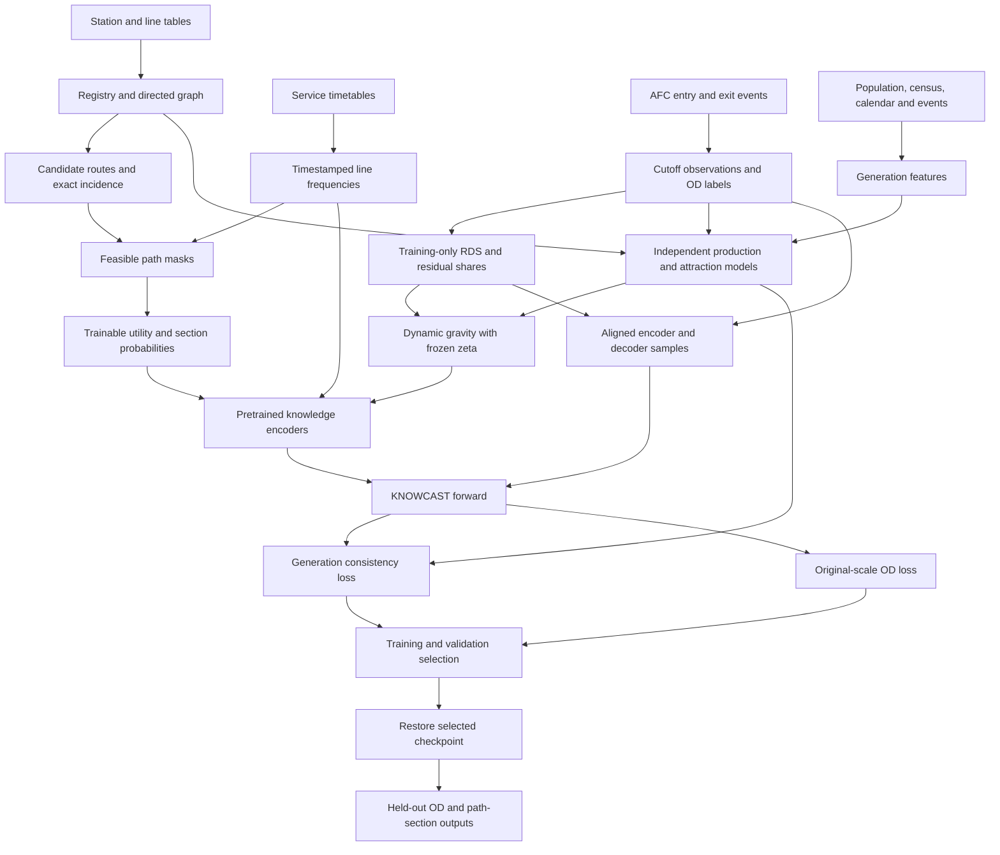

# Artifact and invocation flow

This is a dependency map for the standalone pseudocode, not a website build or an executable launcher. Every box requires validated identities, shapes and provenance before its consumers run.

## Invocation boundaries

| Entry point | Consumes | Produces |
| --- | --- | --- |
| [Artifact pipeline](../generating_domain_knowledge_no_DO_clean.pseudo) | Explicit config, source tables/records, stage selection, required fitted artifacts for reuse | Versioned artifact registry, split bundles, training-fit mappings, auxiliaries, calibration/pretraining artifacts and stage journal |
| [Training](../train_save_history.pseudo) | Training/validation bundles, known maps/transforms, active component artifacts and declared optimization choices | Selected checkpoint, per-epoch checkpoints when requested, histories, selected validation exports and optional sealed final test evaluation |
| [Search](../bayes_opt.pseudo) | Compatible base config, shared split/artifact definitions and resource/search protocol | SQLite study, trial configs/checkpoints, trial CSV/figure and selected-configuration training outputs |
| [Checkpoint evaluation](../evaluate_button.pseudo) | Explicit checkpoint, its manifest, frozen transforms and requested split | Aligned predictions/truth/masks, per-horizon metrics, optional assignments and export manifest |

The independently pretrained generation model and all autoencoders are persistent artifacts. Forward passes reuse registered models. Frequency-only and distribution-without-generation-loss variants retain their required upstream inputs.

The diagram shows the complete model. Ablations prune dependencies according to their active components: raw feature preparation is separate from auxiliary-model training; path outputs can require raw timetables even without the service encoder; Case 3b uses a declared external generic-feature adapter. A disabled component does not automatically require its checkpoint, utility model or autoencoder.

## Missing original dependencies made explicit

The preserved source imports `config.py`, `visualization_tools.plot_graph` and `archieve.train_button`; these were absent from the visible tracked snapshot. The reconstruction supplies [configuration contracts](../config.pseudo) and [six plotting interfaces](../visualization_tools/plot_graph.pseudo), and replaces the missing archive config reader with the common safe configuration-reader contract. The audit inventory identifies these as added interfaces rather than recovered files.

Third-party numerical primitives remain primitive interfaces: tensor algebra/autodiff, a DCRNN recurrent operator, safe YAML parsing, table/raster/database access, optimization and plotting. Their inputs, outputs and required behavior are specified at call boundaries. The original source also delegated these operations to libraries; this edition does not claim to recover or replace their implementations.

Raw AFC records, full timetables, exact model configs, auxiliary/main checkpoints and the original search database remain unavailable. A `REUSE_VERIFIED` stage therefore checks both existence and compatible hashes; it cannot turn an absent input into a placeholder result.
