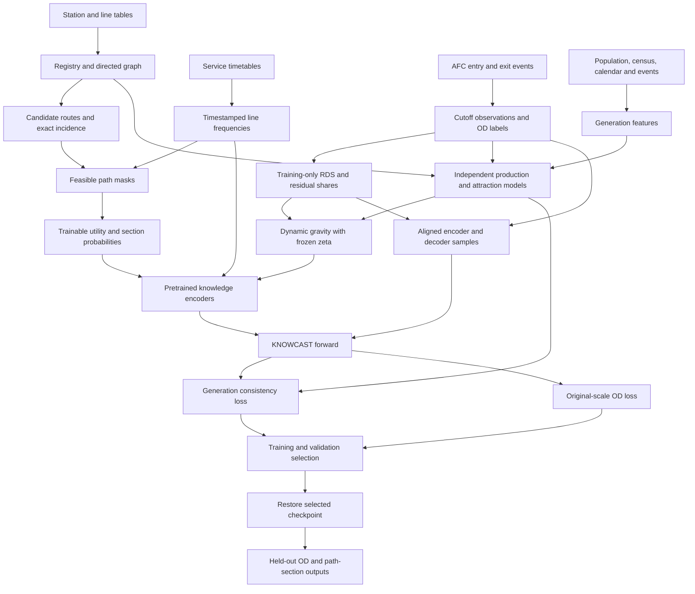

# Data and model workflow

The diagram follows data from source records through model fitting and evaluation.

## Entry points

| Entry point | Consumes | Produces |
| --- | --- | --- |
| [Data pipeline](../generating_domain_knowledge_no_DO_clean.pseudo) | Configuration, source tables, stage selection and existing artifacts selected for reuse | Station registry, split bundles, destination mappings, auxiliary models, calibration and encoder checkpoints |
| [Training](../train_save_history.pseudo) | Training/validation bundles, fitted transforms, active component artifacts and optimizer settings | Selected checkpoint, training histories and prediction exports |
| [Search](../bayes_opt.pseudo) | Base configuration, shared data splits, artifact definitions and search settings | SQLite study, trial configurations, checkpoints and selected-configuration training |
| [Checkpoint evaluation](../evaluate_button.pseudo) | Selected checkpoint, frozen transforms and requested split | Aligned predictions, targets, masks, per-horizon metrics and optional assignments |

## Component dependencies

Generation models and pretrained encoders are loaded once and registered with the forecasting model. Forward passes reuse them. Generation guidance and distribution features both require independent production and attraction estimates. Distribution also reads the target-time impedance matrix.

The diagram shows the complete model. Each variant prepares inputs for its active components:

- Raw generation features can be prepared separately from auxiliary-model training.
- Path feasibility and assignment use raw timetables, including when the service encoder is disabled.
- Each structured encoder uses its own pretrained parameters.
- Case 3b prepares the configured raw features and passes them to the MLP constructed by `Net`.
- Historical day/week/month references are loaded when unfinished-trip branches or a requested diagnostic use them.

## Preparation and reuse

A `BUILD` stage fits or constructs an artifact from its inputs. A `REUSE_VERIFIED` stage loads an existing artifact after matching its configuration, shape, units and IDs. A missing required input returns `Pending(missing)`; an incompatible artifact returns a failure. The pipeline passes the resulting registry to sample generation and training.

[Configuration](../config.pseudo) supplies data sources, dimensions and stage choices. [Plotting](../visualization_tools/plot_graph.pseudo) consumes training histories and aligned prediction records. Numerical backends provide tensor algebra, automatic differentiation, DCRNN operators, optimization, table/raster/database access and plotting through the interfaces in each procedure.
